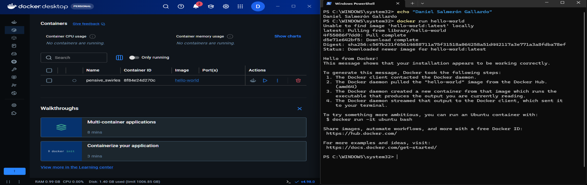
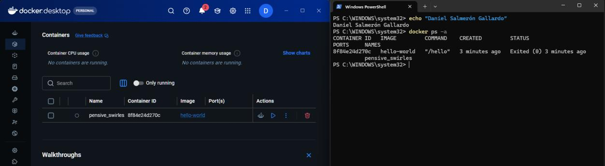
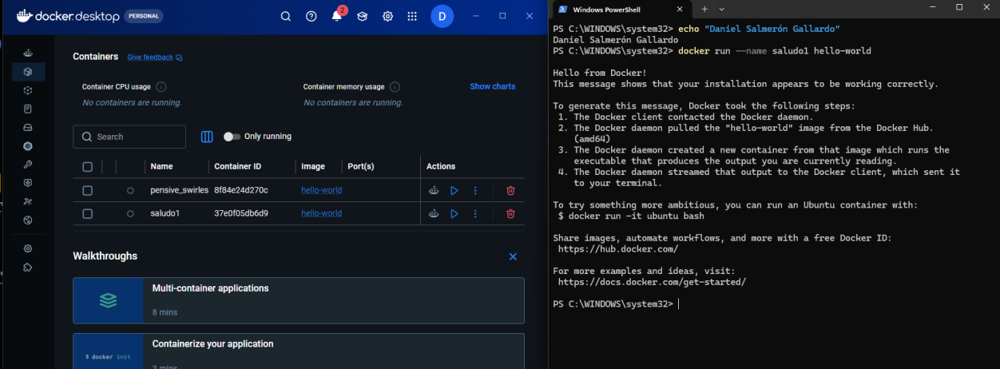
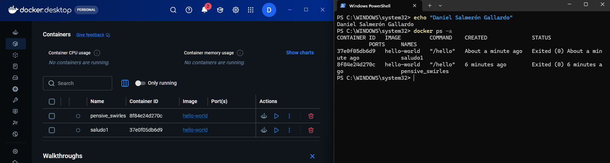
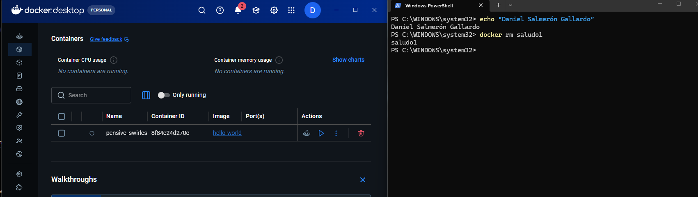
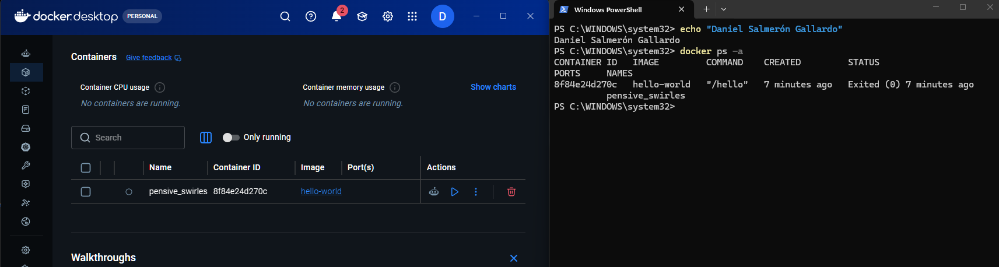
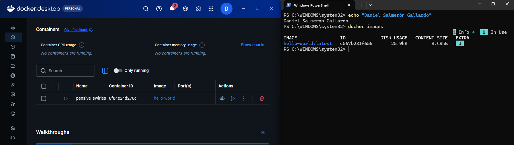
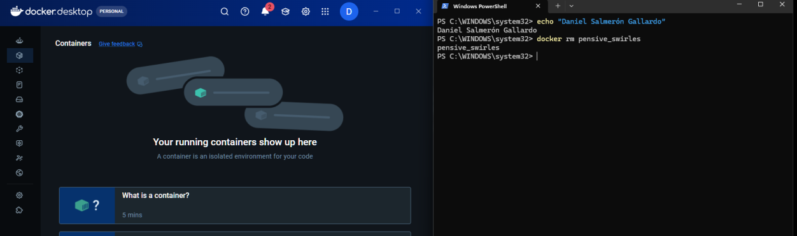
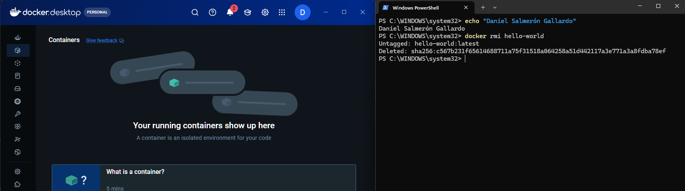
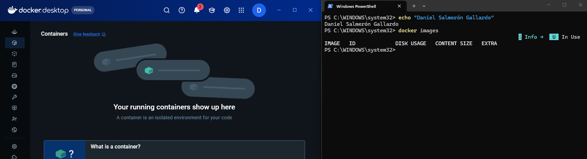

# Práctica Docker: Contenedores efímeros

**Alumno:** Daniel Salmerón Gallardo  
**Fecha:** 09/11/2026

En esta práctica he probado Docker por primera vez. Un contenedor efímero es uno que hace una tarea y se para solo cuando acaba.

---

## Captura 1 – `docker run hello-world`

Ejecuto el contenedor hello-world. Como no tenía la imagen, Docker la busca, no la encuentra y la descarga de Docker Hub. Luego la verifica (la línea del Digest), crea el contenedor, lo ejecuta y sale el mensaje "Hello from Docker!". Cuando termina, el contenedor se para solo. La imagen se queda guardada en mi ordenador, no se borra.

## Captura 2 – `docker ps -a`

Miro los contenedores. Pongo `-a` porque sin él solo salen los que están en marcha, y este ya había terminado. Su ID es `8f84e24d270c` y el estado `Exited (0)`, o sea, terminado y sin errores. Docker le ha puesto un nombre al azar: `pensive_swirles`.

## Captura 3 – `docker run --name saludo1 hello-world`

Ejecuto lo mismo, pero esta vez le pongo yo el nombre al contenedor: `saludo1`. Esta vez no descarga nada porque la imagen ya la tenía.

## Captura 4 – `docker ps -a`

Ahora salen dos contenedores: `pensive_swirles` (nombre aleatorio) y `saludo1` (nombre que puse yo). Es más cómodo ponerles nombre porque es más fácil de recordar y escribir que un ID o un nombre raro.

## Captura 5 – `docker rm saludo1`

Borro el contenedor `saludo1` usando su nombre. Docker contesta con el nombre para confirmar que lo ha borrado.

## Captura 6 – `docker ps -a`

Compruebo que `saludo1` ya no está. Solo queda `pensive_swirles`.

## Captura 7 – `docker images`

Miro las imágenes que tengo. Sigue estando `hello-world`, porque borrar un contenedor no borra la imagen. La "U" significa que la imagen está en uso por un contenedor.

## Captura 7b – `docker rm pensive_swirles`

Borro el primer contenedor, porque si no, Docker no me deja borrar la imagen mientras haya un contenedor que la use.

## Captura 8 – `docker rmi hello-world`

Borro la imagen. Sale "Untagged" (le quita el nombre) y "Deleted" (la borra).

## Captura 9 – `docker images`

Compruebo que ya no hay ninguna imagen. Todo limpio.

---

## Preguntas finales

**¿Diferencia entre `docker rm` y `docker rmi`?**  
`docker rm` borra contenedores y `docker rmi` borra imágenes. La imagen es como la plantilla y el contenedor es lo que se crea a partir de ella.

**¿Qué pasaría si vuelvo a ejecutar `docker run hello-world`?**  
Como ya no tengo la imagen, Docker la volvería a descargar y haría todo igual que en la captura 1.
